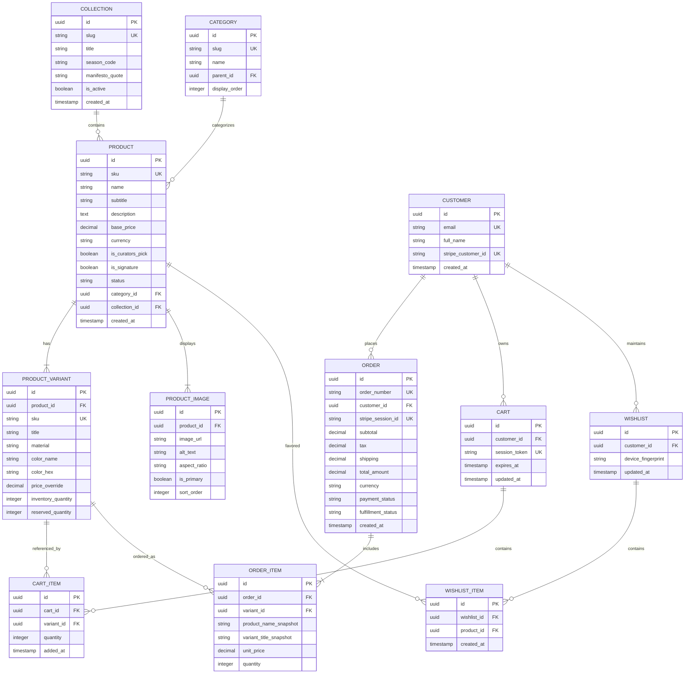

# Database Schema Architecture
## Project: Luxe Editorial Commerce Platform

**Document Version:** 1.0.0  
**Database Engine:** PostgreSQL 16+ (Compatible with Neon, Supabase, Cloud SQL)  
**ORM / Data Layer:** Prisma ORM / Drizzle ORM  
**Related Documents:** [product_requirement_specification.md](file:///home/meghraj-dhakal/Promt_Wars/product_requirement_specification.md) | [system_design_document.md](file:///home/meghraj-dhakal/Promt_Wars/system_design_document.md)

---

## 1. Architectural Principles

1. **Strict Data Integrity:** Normalized schema (3NF) ensuring transactional consistency for inventory, price tags, and order records.
2. **Editorial Capsule Modeling:** First-class support for editorial capsules (e.g., `SS26 Capsule`), exhibition features (`Curator's Pick`, `Signature Edition`), and custom aspect ratios (`4:3`, `4:5`).
3. **High-Read Concurrency:** Composite indexing tailored for high-speed catalog filtering by category, collection, price range, and stock availability.
4. **Resilient Cart & Checkout Sessions:** Fast session handling with temporary inventory reservation holds (15-minute checkout lock).

---

## 2. Entity-Relationship (ER) Diagram



---

## 3. Database Schema Definitions (DDL)

```sql
-- Extensions
CREATE EXTENSION IF NOT EXISTS "uuid-ossp";
CREATE EXTENSION IF NOT EXISTS "pgcrypto";

-- 1. Collections & Capsules
CREATE TABLE collections (
    id UUID PRIMARY KEY DEFAULT gen_random_uuid(),
    slug VARCHAR(64) UNIQUE NOT NULL,
    title VARCHAR(128) NOT NULL,
    season_code VARCHAR(32) NOT NULL, -- e.g. 'SS26'
    manifesto_quote TEXT,
    is_active BOOLEAN DEFAULT TRUE,
    created_at TIMESTAMPTZ DEFAULT NOW(),
    updated_at TIMESTAMPTZ DEFAULT NOW()
);

-- 2. Categories
CREATE TABLE categories (
    id UUID PRIMARY KEY DEFAULT gen_random_uuid(),
    slug VARCHAR(64) UNIQUE NOT NULL,
    name VARCHAR(96) NOT NULL,
    parent_id UUID REFERENCES categories(id) ON DELETE SET NULL,
    display_order INT DEFAULT 0,
    created_at TIMESTAMPTZ DEFAULT NOW()
);

-- 3. Products
CREATE TABLE products (
    id UUID PRIMARY KEY DEFAULT gen_random_uuid(),
    sku VARCHAR(48) UNIQUE NOT NULL,
    name VARCHAR(128) NOT NULL,
    subtitle VARCHAR(255),
    description TEXT,
    base_price NUMERIC(10, 2) NOT NULL CHECK (base_price >= 0),
    currency VARCHAR(3) DEFAULT 'USD',
    is_curators_pick BOOLEAN DEFAULT FALSE,
    is_signature BOOLEAN DEFAULT FALSE,
    status VARCHAR(24) DEFAULT 'ACTIVE' CHECK (status IN ('DRAFT', 'ACTIVE', 'ARCHIVED')),
    category_id UUID NOT NULL REFERENCES categories(id) ON DELETE RESTRICT,
    collection_id UUID REFERENCES collections(id) ON DELETE SET NULL,
    created_at TIMESTAMPTZ DEFAULT NOW(),
    updated_at TIMESTAMPTZ DEFAULT NOW()
);

-- 4. Product Media & Editorial Photography
CREATE TABLE product_images (
    id UUID PRIMARY KEY DEFAULT gen_random_uuid(),
    product_id UUID NOT NULL REFERENCES products(id) ON DELETE CASCADE,
    image_url TEXT NOT NULL,
    alt_text TEXT NOT NULL,
    aspect_ratio VARCHAR(8) DEFAULT '4:5' CHECK (aspect_ratio IN ('4:3', '4:5', '1:1', '16:9')),
    is_primary BOOLEAN DEFAULT FALSE,
    sort_order INT DEFAULT 0
);

-- 5. Product Variants & Inventory
CREATE TABLE product_variants (
    id UUID PRIMARY KEY DEFAULT gen_random_uuid(),
    product_id UUID NOT NULL REFERENCES products(id) ON DELETE CASCADE,
    sku VARCHAR(64) UNIQUE NOT NULL,
    title VARCHAR(96) NOT NULL, -- e.g. 'Standard / Bamboo Handle'
    material VARCHAR(96),
    color_name VARCHAR(48),
    color_hex VARCHAR(7),
    price_override NUMERIC(10, 2) CHECK (price_override >= 0),
    inventory_quantity INT NOT NULL DEFAULT 0 CHECK (inventory_quantity >= 0),
    reserved_quantity INT NOT NULL DEFAULT 0 CHECK (reserved_quantity >= 0),
    created_at TIMESTAMPTZ DEFAULT NOW(),
    updated_at TIMESTAMPTZ DEFAULT NOW()
);

-- 6. Customers
CREATE TABLE customers (
    id UUID PRIMARY KEY DEFAULT gen_random_uuid(),
    email VARCHAR(255) UNIQUE NOT NULL,
    full_name VARCHAR(128),
    stripe_customer_id VARCHAR(128) UNIQUE,
    created_at TIMESTAMPTZ DEFAULT NOW()
);

-- 7. Carts & Cart Items
CREATE TABLE carts (
    id UUID PRIMARY KEY DEFAULT gen_random_uuid(),
    customer_id UUID REFERENCES customers(id) ON DELETE CASCADE,
    session_token VARCHAR(128) UNIQUE NOT NULL,
    expires_at TIMESTAMPTZ NOT NULL,
    updated_at TIMESTAMPTZ DEFAULT NOW()
);

CREATE TABLE cart_items (
    id UUID PRIMARY KEY DEFAULT gen_random_uuid(),
    cart_id UUID NOT NULL REFERENCES carts(id) ON DELETE CASCADE,
    variant_id UUID NOT NULL REFERENCES product_variants(id) ON DELETE CASCADE,
    quantity INT NOT NULL DEFAULT 1 CHECK (quantity > 0),
    added_at TIMESTAMPTZ DEFAULT NOW(),
    CONSTRAINT uq_cart_variant UNIQUE (cart_id, variant_id)
);

-- 8. Orders & Order Items
CREATE TABLE orders (
    id UUID PRIMARY KEY DEFAULT gen_random_uuid(),
    order_number VARCHAR(32) UNIQUE NOT NULL,
    customer_id UUID REFERENCES customers(id) ON DELETE RESTRICT,
    stripe_session_id VARCHAR(128) UNIQUE,
    subtotal NUMERIC(10, 2) NOT NULL,
    tax NUMERIC(10, 2) NOT NULL DEFAULT 0.00,
    shipping NUMERIC(10, 2) NOT NULL DEFAULT 0.00,
    total_amount NUMERIC(10, 2) NOT NULL,
    currency VARCHAR(3) DEFAULT 'USD',
    payment_status VARCHAR(24) DEFAULT 'PENDING' CHECK (payment_status IN ('PENDING', 'PAID', 'FAILED', 'REFUNDED')),
    fulfillment_status VARCHAR(24) DEFAULT 'UNFULFILLED' CHECK (fulfillment_status IN ('UNFULFILLED', 'PROCESSING', 'SHIPPED', 'DELIVERED')),
    created_at TIMESTAMPTZ DEFAULT NOW()
);

CREATE TABLE order_items (
    id UUID PRIMARY KEY DEFAULT gen_random_uuid(),
    order_id UUID NOT NULL REFERENCES orders(id) ON DELETE CASCADE,
    variant_id UUID NOT NULL REFERENCES product_variants(id) ON DELETE RESTRICT,
    product_name_snapshot VARCHAR(128) NOT NULL,
    variant_title_snapshot VARCHAR(96) NOT NULL,
    unit_price NUMERIC(10, 2) NOT NULL,
    quantity INT NOT NULL CHECK (quantity > 0)
);

-- 9. Wishlist
CREATE TABLE wishlists (
    id UUID PRIMARY KEY DEFAULT gen_random_uuid(),
    customer_id UUID REFERENCES customers(id) ON DELETE CASCADE,
    device_fingerprint VARCHAR(128),
    updated_at TIMESTAMPTZ DEFAULT NOW()
);

CREATE TABLE wishlist_items (
    id UUID PRIMARY KEY DEFAULT gen_random_uuid(),
    wishlist_id UUID NOT NULL REFERENCES wishlists(id) ON DELETE CASCADE,
    product_id UUID NOT NULL REFERENCES products(id) ON DELETE CASCADE,
    created_at TIMESTAMPTZ DEFAULT NOW(),
    CONSTRAINT uq_wishlist_product UNIQUE (wishlist_id, product_id)
);
```

---

## 4. Indexing & Optimization Strategy

```sql
-- Performance Indexes for Catalog Browsing
CREATE INDEX idx_products_category_status ON products(category_id, status);
CREATE INDEX idx_products_collection ON products(collection_id);
CREATE INDEX idx_products_price ON products(base_price ASC);
CREATE INDEX idx_products_curator ON products(is_curators_pick) WHERE is_curators_pick = TRUE;

-- Product Image Ordering
CREATE INDEX idx_product_images_sort ON product_images(product_id, sort_order ASC);

-- Inventory & Variant Lookups
CREATE INDEX idx_variants_product ON product_variants(product_id);
CREATE INDEX idx_variants_sku ON product_variants(sku);

-- Cart Expiration Index for TTL Worker
CREATE INDEX idx_carts_expires_at ON carts(expires_at);

-- Orders by Customer & Date
CREATE INDEX idx_orders_customer ON orders(customer_id, created_at DESC);
```

---

## 5. Seed Dataset (SS26 Capsule Catalog)

```sql
-- Insert Capsule Collection
INSERT INTO collections (id, slug, title, season_code, manifesto_quote)
VALUES (
    'c0000000-0000-0000-0000-000000000001',
    'ss26-capsule',
    'SS26 Capsule',
    'SS26',
    'Online commerce should be fast, simple, and modern.'
);

-- Insert Category
INSERT INTO categories (id, slug, name, display_order)
VALUES (
    'a0000000-0000-0000-0000-000000000001',
    'accessories',
    'Accessories',
    1
);

-- Insert 7 Initial Capsule Products
INSERT INTO products (id, sku, name, subtitle, base_price, is_curators_pick, is_signature, category_id, collection_id)
VALUES
('p0000000-0000-0000-0000-000000000001', 'YNS-ACC-001', 'Azure Drift', 'Leather Goods', 613.77, TRUE, FALSE, 'a0000000-0000-0000-0000-000000000001', 'c0000000-0000-0000-0000-000000000001'),
('p0000000-0000-0000-0000-000000000002', 'YNS-ACC-002', 'Ocean Bloom', 'Tote', 553.50, FALSE, FALSE, 'a0000000-0000-0000-0000-000000000001', 'c0000000-0000-0000-0000-000000000001'),
('p0000000-0000-0000-0000-000000000003', 'YNS-ACC-003', 'Le Bag Autre', 'Edition Limitée', 2458.77, FALSE, TRUE, 'a0000000-0000-0000-0000-000000000001', 'c0000000-0000-0000-0000-000000000001'),
('p0000000-0000-0000-0000-000000000004', 'YNS-ACC-004', 'Aqua Stride Bottle', 'Drinkware', 121.77, FALSE, FALSE, 'a0000000-0000-0000-0000-000000000001', 'c0000000-0000-0000-0000-000000000001'),
('p0000000-0000-0000-0000-000000000005', 'YNS-ACC-005', 'Horizon Gaze Sunglasses', 'Eyewear', 61.50, FALSE, FALSE, 'a0000000-0000-0000-0000-000000000001', 'c0000000-0000-0000-0000-000000000001'),
('p0000000-0000-0000-0000-000000000006', 'YNS-ACC-006', 'Shadow Stride Shoes', 'Footwear', 147.60, FALSE, FALSE, 'a0000000-0000-0000-0000-000000000001', 'c0000000-0000-0000-0000-000000000001'),
('p0000000-0000-0000-0000-000000000007', 'YNS-ACC-007', 'Sunbeam Tote', 'Canvas Tote', 121.77, FALSE, FALSE, 'a0000000-0000-0000-0000-000000000001', 'c0000000-0000-0000-0000-000000000001');

-- Insert Primary Images
INSERT INTO product_images (product_id, image_url, alt_text, aspect_ratio, is_primary)
VALUES
('p0000000-0000-0000-0000-000000000001', 'https://lh3.googleusercontent.com/aida-public/AB6AXuAFBXHK8drnnP9l7NsNXoazb2ZeEwYd7WG7iSL95e9WKldh74rX2p0cMVV1oqFn83LaNkdvbPN5g-htuGoSJOepBmSI9U3axvWuBanD_dws2c1FoDFshsjYGKV8-jQUKvLaaltAxY6pKhUUVc-cAoia4p7flw7KYG3fluRAaL57s4QafkQFp6v8KfSqJCa6t4NsBtXW4mlE8l_yTWiUlO0l9YqmR3hA06jcixItl5GX', 'Azure Drift Luxury Bag', '4:3', TRUE),
('p0000000-0000-0000-0000-000000000002', 'https://lh3.googleusercontent.com/aida-public/AB6AXuCGhW40SSbL1Mb61hI2ByCrnYmucwLiGPrzmG_j2-pWFi5dOirCvbacDjms1Mywvt2vkoVVUV7GBET9vbcRynAiKXWYR-PYqNM6k-yAsDKA_gdm-3P2Q27xhJS0Eh_tRR6B0QUKx9xSPpmmtjIXVOnayWyLi4z_M8IeYfLGO7h36eDEoqhW4iMz8bjTrYaKBgV1yFDdAwhqCfxa8v5-vDzPeHtJEF1QUKuGZnlC2S-a', 'Ocean Bloom Bag', '4:5', TRUE),
('p0000000-0000-0000-0000-000000000003', 'https://lh3.googleusercontent.com/aida-public/AB6AXuCWxOljzOGVKz4x4LpPvY9yuZjDtG2aJBanv5gKISb3z5-VqGbnKa2gsSFpZ70Hw1R8DmlNJZTLeUiOjKhX0zlooBIwFKMYD_63o6lvnPqHFWg5Op7H3F082Syim5qkR6fZNxm6e_YdJHRFOBcaeB97cARYtivtU810YoV7wrYqkr5iX1xAM3qeKh9fpriM85qLAH_AiR8vb1_HnPQ5bYsSNU_jGoPQ24b6briY_eln', 'Le Bag Autre', '4:5', TRUE),
('p0000000-0000-0000-0000-000000000004', 'https://lh3.googleusercontent.com/aida-public/AB6AXuA4M9Xkburnj7wVjerQuDbo3wYzrNOzcb2Ac0T_q-ZQT7nMHBV8WpzEUDK6tsEp2SZ2quInRGjnSXaOk_oioghPQCJAnZF9d_vJmySMBqQ4dDqLfBMx_2d4c1LsLGO-W0HUagWNfqrlCTPo4tflHDxvzzw_e6LLGpIn0v5I6lf9LGgnnIsqjaKrMhlZ69RxUVyGEvQrAl6r_Z83bYqWM3kpgwpg7ksdQfbyO3CZ_U1x', 'Aqua Stride Bottle', '4:5', TRUE),
('p0000000-0000-0000-0000-000000000005', 'https://lh3.googleusercontent.com/aida-public/AB6AXuBVYFoKGzSiTRSNXeWxWCgb3hM21eu692d3IvIErdW-WT4Hfqm4waFuBwnQj0SYGlJHWk0NSt1u3NbpnBI8ipX3CBliibtpqkfJJW1znPUVbL1ClHuW2H_PNV2TyDpYmikTAolBaie6BPz-1kXLfzPftgMwj6pojLAgxrIamMPELSUUs5H0gwanc9Iph3Rd1ujKrHaRkmTEDcIv86_Mde4gOJgH1OmVzHKqvitKIXYA', 'Horizon Gaze Sunglasses', '4:5', TRUE),
('p0000000-0000-0000-0000-000000000006', 'https://lh3.googleusercontent.com/aida-public/AB6AXuC-7rNap8iLkKSBe-NfIhu4TiysoY_PWnFCQJaRRVlTao-h1dtAn_8WY77gipZO5ojo0rhHxz3c685qrirSxh37D4j0NL4jrPTiGCkFpYYh-vWjCezTfF4lEvqwIjZZowA_jV2qPMEOkZdBXf9U3J6SMI82aGzPtPG1s2acdaHl4WGvM7vRs9sO-9UUkLRH1aA4HSpchctmhQzm9rJ_XV5QgCrfGAuD3gwbIlhXGslJ', 'Shadow Stride Shoes', '4:5', TRUE),
('p0000000-0000-0000-0000-000000000007', 'https://lh3.googleusercontent.com/aida-public/AB6AXuBjcL-_7jFsDm7Q2YXKkJ-RT1NPMZ3Nlgs01271V6gcdi4NHPUf2Vx2vpuG9dZCqwHYiSpzXx7A1lW_xL462lJPt0yygA5lG2VDLZRKGxfNGHJWHk3e90Zq3b45BUNTMCtINkFAkMErcEuMuAk4azoxycdhwQUn_eofhiEWSigUUZT7eVgwj6UJkRTTlyXDKABZz-J-sQS6QzK0gj0S3oNbJQmCXizJIkx48VAR8wDS', 'Sunbeam Tote', '4:5', TRUE);
```
