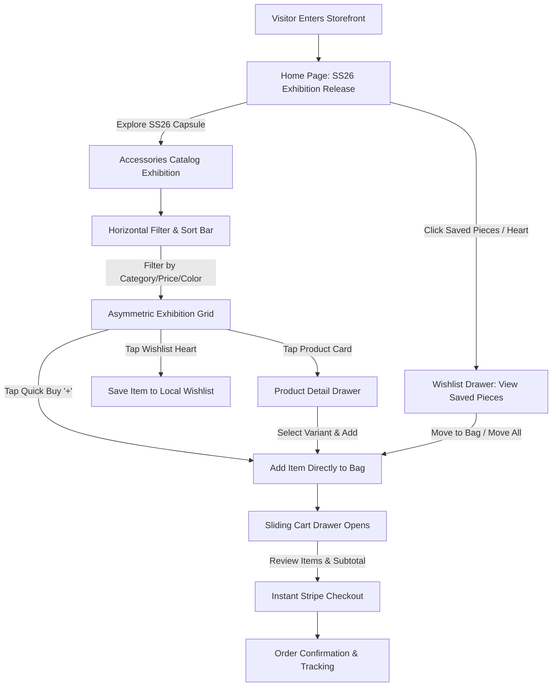
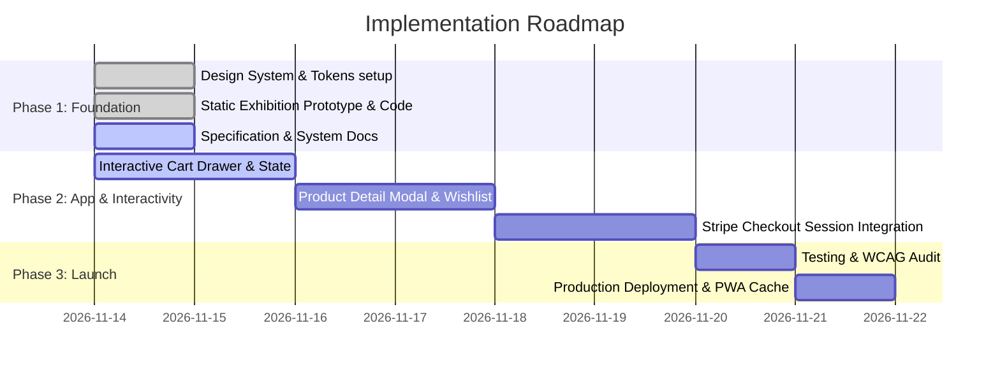

# Product Requirements Specification (PRS)
## Project: Luxe Editorial Commerce (SS26 Capsule)

**Document Version:** 1.0.0  
**Status:** Approved for Implementation  
**Target Platform:** Mobile-First Responsive Web (PWA-Ready)  
**Reference Design System:** [DESIGN.md](file:///home/meghraj-dhakal/Promt_Wars/DESIGN.md)  
**Reference Prototype:** [code.html](file:///home/meghraj-dhakal/Promt_Wars/code.html) | [screen.png](file:///home/meghraj-dhakal/Promt_Wars/screen.png)

---

## 1. Executive Summary & Vision

### 1.1 Product Vision
**Luxe Editorial Commerce** transforms conventional, utilitarian e-commerce into an avant-garde luxury editorial exhibition. Pairing high-fashion publication prestige with modern digital fluidity, the storefront presents each product as a curated gallery artifact rather than standard warehouse SKU inventory.

### 1.2 Core Value Proposition
- **High-Fashion Prestige:** Dramatic high-contrast typography featuring *Playfair Display* serif headlines, *Space Grotesk* technical labels, and *Geist* body copy.
- **Warm Gallery Neutrals:** Tactile museum backdrops (*Gallery Alabaster* `#F8F6F2`, *Obsidian Ink* `#121214`) that emphasize natural product textures.
- **Friction-Free Mobile Ergonomics:** Floating acrylic glass navigation island, one-tap quick-buy price capsules, and a sliding drawer cart.
- **Stripe-Native Checkout:** Minimalist, high-conversion checkout flows supporting modern digital wallets (Apple Pay, Google Pay, Klarna, Cards).

---

## 2. User Personas & Target Audience

| Persona | Demographics | Needs & Expectations | Pain Points |
| :--- | :--- | :--- | :--- |
| **Elena Vance** (32) *Design Director* | Milan / NYC High disposable income | Curated discovery, visual elegance, editorial backstories, high-res texture clarity. | Cluttered discount banners, low-resolution catalog grids, slow page loads. |
| **Julian Thorne** (28) *Tech Founder* | London / SF Values speed & craft | Seamless mobile purchasing, instant Apple Pay checkout, clean typography, transparent stock. | Friction-heavy checkout flows, multi-step forms, unstyled mobile portals. |
| **Maya Lin** (25) *Fashion Stylist* | Tokyo / Paris Trend-forward | Capsule collection drops, wishlist curation, easy sharing, distinct limited releases. | Repetitive generic templates, lack of editorial distinction between items. |

---

## 3. Product Architecture & User Journey

---

## 4. Detailed Feature Specifications

### 4.1 Home Page (Editorial Landing Exhibition)
- **Grand Hero Exhibition Banner**: 
  - Dynamic display typography (*Playfair Display*, 54px desktop / 38px mobile): *"Form, Texture & Permanence."*
  - Active pulse capsule badge: `SS26 Exhibition Release`.
  - Primary CTA pill: `"Explore SS26 Capsule"` (switches to catalog).
  - Secondary CTA pill: `"Saved Pieces"` (triggers Wishlist drawer).
- **Curated Department Portals**: 
  - 3 high-contrast portal cards linking to catalog departments:
    1. *Leather Goods & Totes* (4 pieces, sculpted bamboo handles, calfskin).
    2. *Footwear & Strides* (1 piece, midnight charcoal woven soles).
    3. *Vessels & Eyewear* (2 pieces, thermal bronze, amber acetate).
- **Curator’s Exhibition Spotlight**: 
  - Showcases flagship piece (*Le Bag Autre*, $2,458.77) with signature edition badge, editorial critique, and direct `"Acquire Piece"` trigger.
- **Atelier Craftsmanship Pillars**:
  - Highlights *Artisanal Provenance* (Florence & Milan master tanneries), *Frictionless Commerce* (instant Stripe/Apple Pay/Klarna), and *Carbon Neutral Delivery* (verified carbon offset).

### 4.2 Header & Top App Bar
- **Branding**: Left-aligned monogram badge + `"YOUR NEXT STORE"` in uppercase tracked `title-editorial` typography (acts as Home trigger).
- **Desktop Navigation Links**: Direct navigation to `Home`, `Accessories`, and `SS26 Capsule`.
- **Navigation Controls**:
  - Drawer menu icon trigger (left).
  - Search modal trigger button (right).
  - Dedicated Wishlist trigger button with live Coral Red badge counter (`#FF3823`).
  - Shopping Bag trigger with live dynamic pill badge counter (highlighted in Electric Cobalt `#2B4CFF`).
- **Visual Style**: Frosted sticky backdrop blur (`backdrop-blur-md`), 1px subtle hairline border (`#E7E4DC`), dark/light mode adaptable.

### 4.3 Dedicated Wishlist Drawer & Management
- **Slide-Over Panel**: Dedicated right-side drawer opening from header wishlist icon, bottom navigation island, or in-page triggers.
- **Wishlist State & Persistence**: Synchronized in real time with client `localStorage` (`yns_wishlist`).
- **Individual Item Actions**:
  - Item preview with thumbnail, title, category, subtitle, and price.
  - One-tap `"To Bag"` button that immediately transfers the item to the active cart and removes it from the wishlist.
  - Delete / Remove action icon.
- **Batch Actions**: `"Move All to Shopping Bag"` CTA button.
- **Empty State**: Tailored illustration with `"Browse SS26 Capsule"` call to action.
- **Total Curation Valuation**: Displays the aggregated value of all favorited items.

### 4.2 Editorial Hero & Masthead
- **Capsule Badge**: Full pill curvature badge containing an active Electric Cobalt pulsing dot and uppercase text: `SS26 CAPSULE`.
- **Item Count Metadata**: Subdued counter indicator displaying total pieces in collection (e.g. `7 Pieces Selected`).
- **Editorial Headline**: Display Hero typography (`Playfair Display`, 44px desktop / 34px mobile) with high-contrast serif presence: `"Accessories"`.
- **Brand Subtitle**: Concise manifesto: *"Curated objects of form & function. Online commerce should be fast, simple, and modern."*

### 4.3 Refined Horizontal Filter Bar
- **Touch-Optimized Carousel**: Smooth horizontal scroll with hidden scrollbar (`.no-scrollbar`).
- **Filter Controls**:
  - `FILTERS` master button with `tune` icon and solid Obsidian fill (`#121214`).
  - Active selection indicator pill (e.g. `Lifestyle` with active `#2B4CFF` cobalt dot).
  - Category / attribute pills: `Color`, `Price`.
  - `Sort` dropdown pill with expanding chevron indicator.
- **Haptic/Micro Interactions**: Active scale down (`active:scale-95`) with smooth CSS transitions.

### 4.4 Curated Asymmetric Exhibition Grid
The catalog breaks away from monotonous e-commerce grids using calculated editorial pacing:
1. **Hero Exhibition Feature (4:3 aspect ratio, span 2 columns on desktop)**:
   - Reserved for *Curator’s Pick* or flagship collection items (e.g., *Azure Drift* Sky Blue Bag).
   - Floating curator badge (`rgba(18,18,20,0.7)` backdrop blur).
   - Floating wishlist trigger (36px circular frosted glass button with vector heart).
   - Floating price capsule (`#FFFFFF` pill with `#121214` Space Grotesk pricing).
   - Floating quick-buy trigger button (`#121214` circle with white `+` icon, transitions to Electric Cobalt on tap).
2. **Standard Editorial Tiles (4:5 aspect ratio, 2 columns on tablet/desktop, 1 column on mobile)**:
   - High-contrast studio product imagery with subtle internal shadows and clean clipping.
   - Micro-tags (e.g. `Signature`, `Edition Limitée`, `In Stock`).
   - Metadata grouping: Category label (uppercase tracked `label-caps`), Product Name (`headline-md`), and Material/Variant subtitle.

### 4.5 SS26 Capsule Catalog Roster (Initial Scope)
| SKU | Product Name | Category | Variant / Material | Price (USD) | Special Badges |
| :--- | :--- | :--- | :--- | :--- | :--- |
| `YNS-ACC-001` | **Azure Drift** | Leather Goods | Bamboo Curved Handle / Sky Blue Calfskin | $613.77 | Curator’s Pick, In Stock |
| `YNS-ACC-002` | **Ocean Bloom** | Tote | Dual Tone Ochre Handle / Cobalt Leather | $553.50 | - |
| `YNS-ACC-003` | **Le Bag Autre** | Edition Limitée | Deep Burgundy Polished Calfskin | $2,458.77 | Signature Edition |
| `YNS-ACC-004` | **Aqua Stride Bottle** | Drinkware | Thermal Bronze Anodized Cap / Dark Matte | $121.77 | Eco Insulation |
| `YNS-ACC-005` | **Horizon Gaze Sunglasses** | Eyewear | Amber Sepia Lenses / Black Acetate | $61.50 | UV400 Protection |
| `YNS-ACC-006` | **Shadow Stride Shoes** | Footwear | Midnight Charcoal Woven / Minimal Soles | $147.60 | Ergonomic Cushion |
| `YNS-ACC-007` | **Sunbeam Tote** | Canvas Tote | Terracotta Botanical Emboss / Tassels | $121.77 | Artisanal Series |

### 4.6 Brand Manifesto Banner
- Full-width dark exhibition panel (`#121214`) with architectural ambient concentric arcs.
- Manifesto quote: *“Online commerce should be fast, simple, and modern.”*
- Social channels (X/Twitter, LinkedIn) and verified badge (*“Made with YNS”*).

### 4.7 Sliding Cart Drawer & Quick Buy Flow
- **Slide-Over Panel**: Smooth sliding drawer from the right on desktop, bottom sheet on mobile.
- **Cart Line Items**: Thumbnail, variant label, quantity decrement/increment, item price, item removal trigger.
- **Real-Time Calculation**: Subtotal, estimated shipping tier (with free shipping progress bar at $250+), sales tax, and final total.
- **Checkout Action**: Prominent pill button in Electric Cobalt (`#2B4CFF`) or Obsidian (`#121214`) linking directly to secure Stripe session.

### 4.8 Floating Island Navigation
- **Docked Position**: Fixed 16px above bottom viewport (`safe-area-inset-bottom` compliant).
- **Material**: Frosted acrylic glass (`rgba(255, 255, 255, 0.88)` / `backdrop-blur-xl`) with 1px border.
- **Destinations**:
  1. `Discover` (active state with filled explore icon)
  2. `Search`
  3. `Curated`
  4. `Bag` (with live circular pill badge)

---

## 5. Non-Functional Requirements (NFRs)

- **Performance**: Lighthouse Mobile Score ≥ 95; First Contentful Paint (FCP) ≤ 0.8s; Largest Contentful Paint (LCP) ≤ 1.2s; Cumulative Layout Shift (CLS) = 0.
- **Accessibility**: WCAG 2.1 Level AA compliance, 44×44px minimum interactive touch targets, semantic landmarks (`<header>`, `<main>`, `<section>`, `<nav>`, `<footer>`).
- **Browser Compatibility**: Safari (iOS 15+), Chrome (Mobile/Desktop), Firefox, Edge.
- **Localization & Currency**: Default USD ($), ISO 4217 compliant, formatting with `Intl.NumberFormat`.

---

## 6. Implementation Milestones

