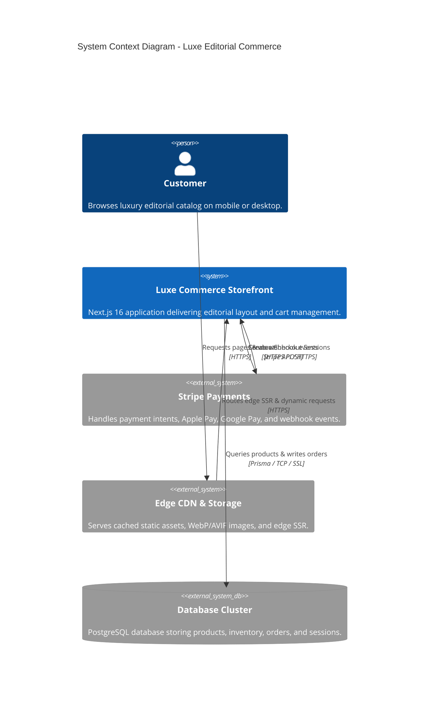
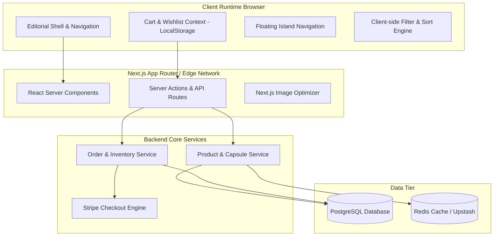
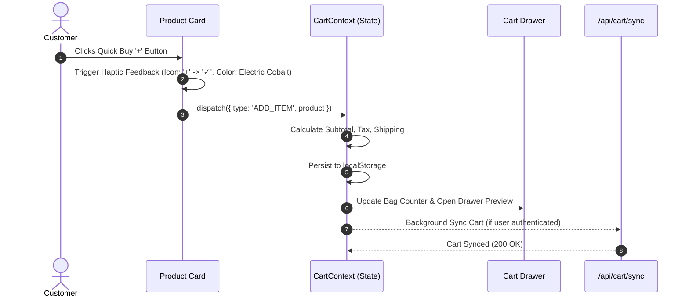
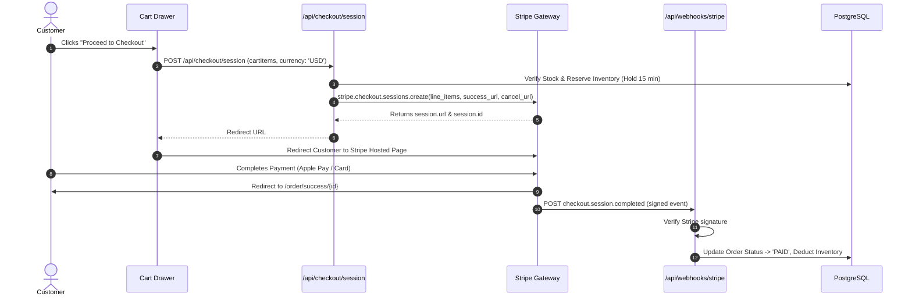

# System Design Document (SDD)
## Project: Luxe Editorial Commerce Platform

**Document Version:** 1.0.0  
**Status:** Approved for Implementation  
**Architecture Style:** Jamstack / Next.js Edge-Enabled Headless E-Commerce  
**Related Documents:** [product_requirement_specification.md](file:///home/meghraj-dhakal/Promt_Wars/product_requirement_specification.md) | [database_schema_architecture.md](file:///home/meghraj-dhakal/Promt_Wars/database_schema_architecture.md)

---

## 1. Architectural Overview

The **Luxe Editorial Commerce** architecture delivers sub-second page loads, resilient offline/PWA capabilities, and instantaneous checkout flows. It employs a decoupled frontend utilizing Server Components (RSC) and Client Islands, backed by an edge API layer, relational persistent storage, and Stripe's high-conversion payment engine.

### 1.1 System Context Diagram (C4 Level 1)



---

## 2. Container & Component Architecture

### 2.1 Container Decomposition



### 2.2 Component Hierarchy & Responsibilities

1. **Root Layout (`app/layout.tsx`)**:
   - Injects global typographic styles (*Playfair Display*, *Space Grotesk*, *Geist*).
   - Injects theme context (Light Alabaster / Dark Obsidian).
   - Initializes `CartProvider` and `WishlistProvider`.
2. **TopAppBar Component (`components/navigation/top-bar.tsx`)**:
   - Docked sticky header with frosted glass backdrop filter (`backdrop-blur-md`).
   - Handles hamburger drawer toggle, search trigger, and active cart counter.
3. **HeroSection Component (`components/sections/hero-capsule.tsx`)**:
   - Renders editorial masthead, SS26 pill badge, and collection piece count.
4. **FilterBar Component (`components/catalog/filter-bar.tsx`)**:
   - No-scrollbar horizontal carousel.
   - Manages filter state (`lifestyle`, `color`, `priceRange`, `sortBy`).
5. **ProductGrid Component (`components/catalog/product-grid.tsx`)**:
   - Renders asymmetric layout: 1st card as 4:3 full-width exhibition tile, subsequent cards in 4:5 responsive 2-column format.
   - Sub-components: `PriceCapsule`, `WishlistTrigger`, `QuickBuyButton`, `BadgeMicro`.
6. **CartDrawer Component (`components/cart/cart-drawer.tsx`)**:
   - Sliding right-side overlay with backdrop blur.
   - Live item quantity controls, subtotal math, and free-shipping progress meter.
7. **BottomIslandNav Component (`components/navigation/floating-island.tsx`)**:
   - Docked floating pill container with bottom safe-area insets.
   - Navigation routes: Discover, Search, Curated, Bag.

---

## 3. Data Flow & Transaction Sequences

### 3.1 Quick Buy & Cart Management Flow



### 3.2 Stripe Checkout Flow



---

## 4. API Interface Specifications

### 4.1 RESTful Endpoints

#### `GET /api/products`
Retrieves filtered and sorted product catalog.
- **Query Parameters**:
  - `category` (string, e.g. `"accessories"`)
  - `capsule` (string, e.g. `"ss26"`)
  - `sort` (enum: `"price-asc"`, `"price-desc"`, `"curated"`, `"newest"`)
  - `limit` (integer, default: 20)
- **Response `200 OK`**:
```json
{
  "data": [
    {
      "id": "prod_01JAZZ...",
      "sku": "YNS-ACC-001",
      "name": "Azure Drift",
      "category": "Leather Goods",
      "price": 613.77,
      "currency": "USD",
      "isCuratorsPick": true,
      "inStock": true,
      "imageUrl": "https://images.example.com/azure-drift.png",
      "aspectRatio": "4:3",
      "details": "Sky blue calfskin with bamboo handle"
    }
  ],
  "meta": {
    "total": 7,
    "capsule": "SS26 Capsule"
  }
}
```

#### `POST /api/checkout/session`
Initiates a Stripe checkout session from cart contents.
- **Request Body**:
```json
{
  "items": [
    { "productId": "prod_01JAZZ...", "quantity": 1 }
  ],
  "successUrl": "https://store.example.com/order/success?session_id={CHECKOUT_SESSION_ID}",
  "cancelUrl": "https://store.example.com/category/accessories"
}
```
- **Response `200 OK`**:
```json
{
  "sessionId": "cs_test_a1b2c3d4...",
  "checkoutUrl": "https://checkout.stripe.com/c/pay/cs_test_..."
}
```

---

## 5. Performance, Caching & Resilience Strategy

| Layer | Technology | Cache Strategy | TTL | Invalidation Trigger |
| :--- | :--- | :--- | :--- | :--- |
| **Edge HTML** | Vercel Edge / Cloudflare | `stale-while-revalidate` | 60s (S-MaxAge: 3600) | On-demand via webhook / product edit |
| **Media Assets** | Cloudinary / Next Image | Immutable cache header | 1 Year (`immutable`) | Hash in asset URL |
| **API Queries** | Upstash Redis | Cache-aside | 300s | Inventory change event |
| **Client State** | LocalStorage / IndexedDB | Persistent device cache | Indefinite | User cart clear / order completion |

---

## 6. Security, Compliance & Observability

- **PCI-DSS Level 1 Compliance**: Delegated to Stripe Elements/Checkout; zero cardholder data touches the application servers.
- **Content Security Policy (CSP)**:
  ```http
  Content-Security-Policy: default-src 'self'; script-src 'self' 'unsafe-inline' https://cdn.tailwindcss.com https://js.stripe.com; style-src 'self' 'unsafe-inline' https://fonts.googleapis.com; font-src https://fonts.gstatic.com; img-src 'self' data: https:; connect-src 'self' https://api.stripe.com;
  ```
- **Webhook Signature Verification**: All incoming Stripe events are validated via `stripe.webhooks.constructEvent()` with raw payload buffers to defeat replay attacks.
- **Error Tracking & Telemetry**: Sentry integration for client-side crash telemetry and OpenTelemetry tracing for API routes.
